# SongPulse

A lightweight Windows desktop music identifier that listens directly to your PC's system audio, even while wearing headphones or using multiple audio outputs, with optional local AI rescue for tricky tracks.

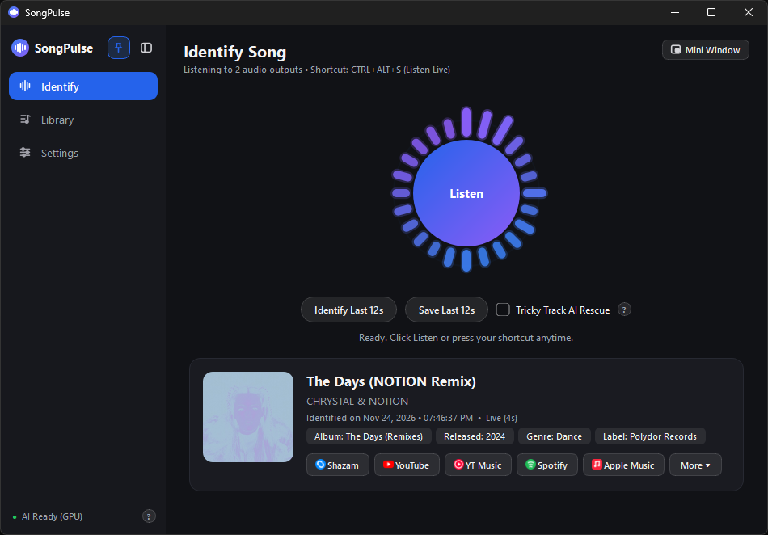

---

## Features (v1.2.0)

- **Multi-Output Desktop Audio Capture:** Listens directly to one or more Windows playback devices simultaneously via WASAPI loopback without needing a microphone or virtual audio cables. Includes an option to disable the rolling RAM buffer when you only want Listen Live.

  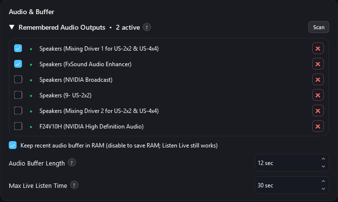
- **Two Listening Modes + Mini Window & Saved Clip Testing:**
  - **Listen (Live):** Continuously monitors playing audio with non-blocking probes and instant cancellation. Also supports your selected local AI rescue model when enabled.
  - **Identify Last (Rolling Buffer):** Keeps the last 5 to 30 seconds of desktop audio in RAM so you can identify a track you just heard immediately, or **Save Last Xs** to test a captured clip against multiple AI models without losing the audio.
  - **Mini Window:** Compact always-on-top mini window with live waveforms, Listen, Identify Last, and AI Rescue toggle.

  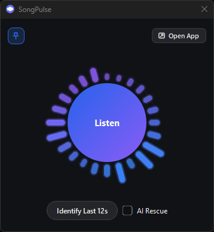 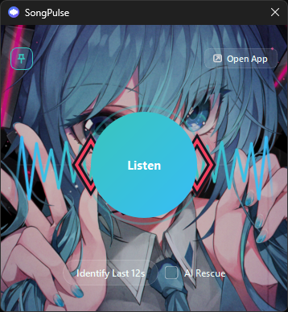 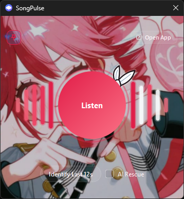 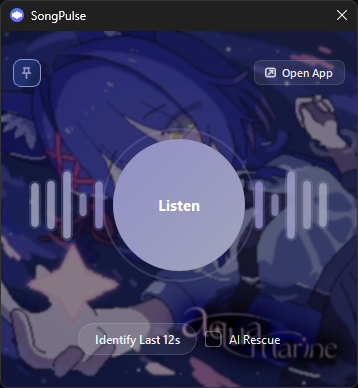
- **Optional Tricky-Track Local AI Rescue (Saves Space):**
  - Core SongPulse installs with **no AI engine or models downloaded by default**.
  - Choose from curated tricky-track rescue models in **Settings -> AI Models** (or during Setup): **De-Reverb HQ**, **UVR De-Echo & De-Reverb**, **UVR DeNoise (SFX & Static)**, **UVR Crowd Remover**, **Whisper Lyrics Rescue (Tiny / Base)** for sped-up, slowed+reverb, and covers, **UVR Inst HQ 3**, or import your own custom `.onnx` / `.pth` / `.ckpt` model.
  - Built-in speed/pitch rescue sweep for sped-up and slowed tracks, plus smart GPU load guard with automatic CPU fallback.

  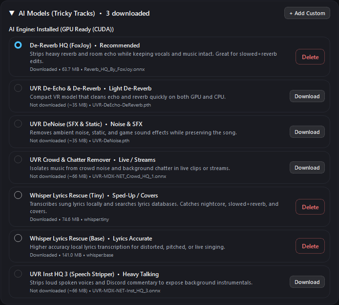
- **Reworked Library, Playlists & yt-dlp Integration:**
  - Switch between **Identified Songs**, **Liked Songs**, and unlimited **Custom Playlists**.
  - Reorder custom playlists manually via drag-and-drop or move arrows, or sort by Date, Title, Artist, Genre, or Album.
  - **Download Playlist:** One-click button to download the active playlist into a new subfolder named after the playlist via `yt-dlp-downloader`.
  - Multi-select checkboxes and **Select All** with a sticky top **Add to Playlist**, **Batch Download (yt-dlp)** (preserving the exact order songs were selected, without creating a new subfolder), and **Clear Selected** action bar that follows while scrolling.
  - Right-click any song in the Library to **Like/Unlike**, **Listen in** your preferred music site, **Add to Playlist**, or **Download** via `yt-dlp-downloader`.
  - **Quick MP3 Download (Default ON):** Automatically launches `yt-dlp-downloader` via `ytdlp://` URI with the Music preset (preferring audio-only YouTube Music song links first and falling back to video if unavailable) and closes it automatically once downloads finish.

  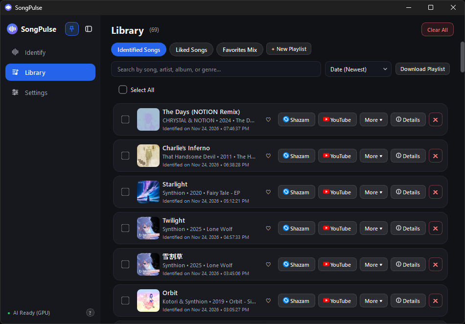
  <br>
  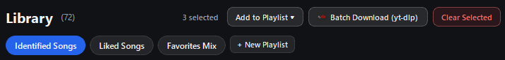

- **Custom Themes, Miku & Teto Themes, and Custom Waveforms:**
  - Built-in **Match Windows**, **Dark**, **Light**, **Miku** (blue gradient, Miku sidebar cutout, diamond hair ties, and stereo Pulse Line waveform), and **Teto** (crimson gradient, Teto sidebar cutout, top-right white bow, and stereo Horizontal Split waveform with alternating red/white right bars).
  
  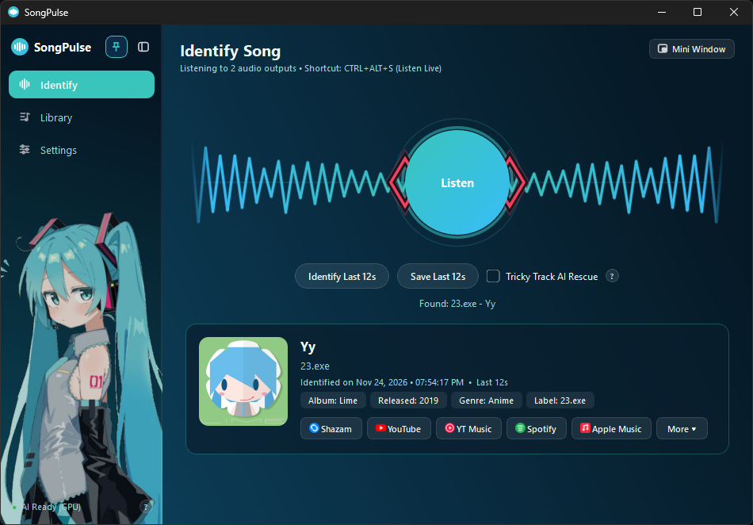 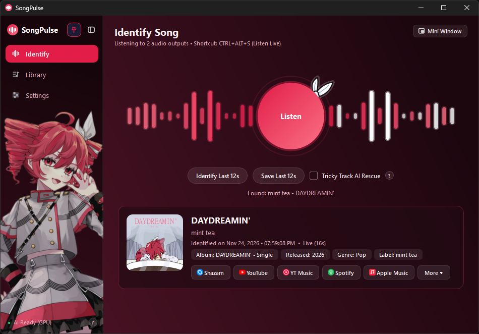

  - Create custom themes visually with a live preview in **Settings -> Create Theme** or edit JSON templates in `custom_themes/` with solid colors, gradients, or photos for the background, sidebar, and mini-player (including an optional **Synthion** preset in `custom_themes/synthion/`).
  - Customize waveform shape (**Radial**, **Horizontal Split**, **Pulse Line**, **Bottom Bar**, **Dots Ring**), mirroring, idle resting dots, and max width.

  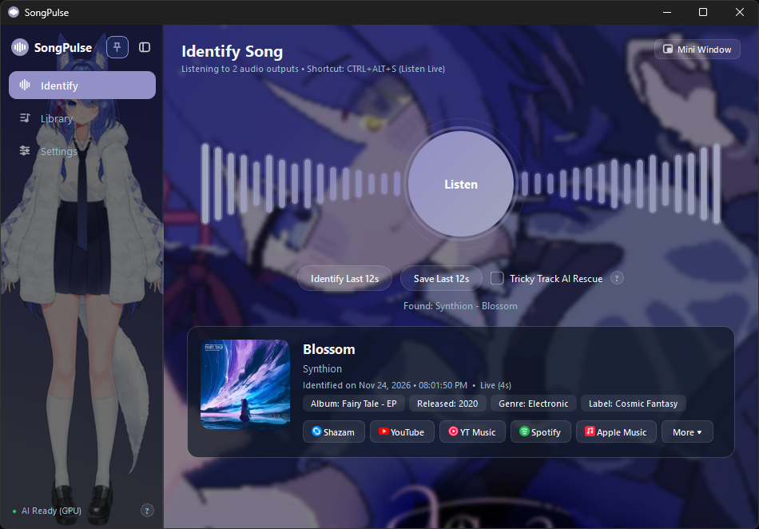 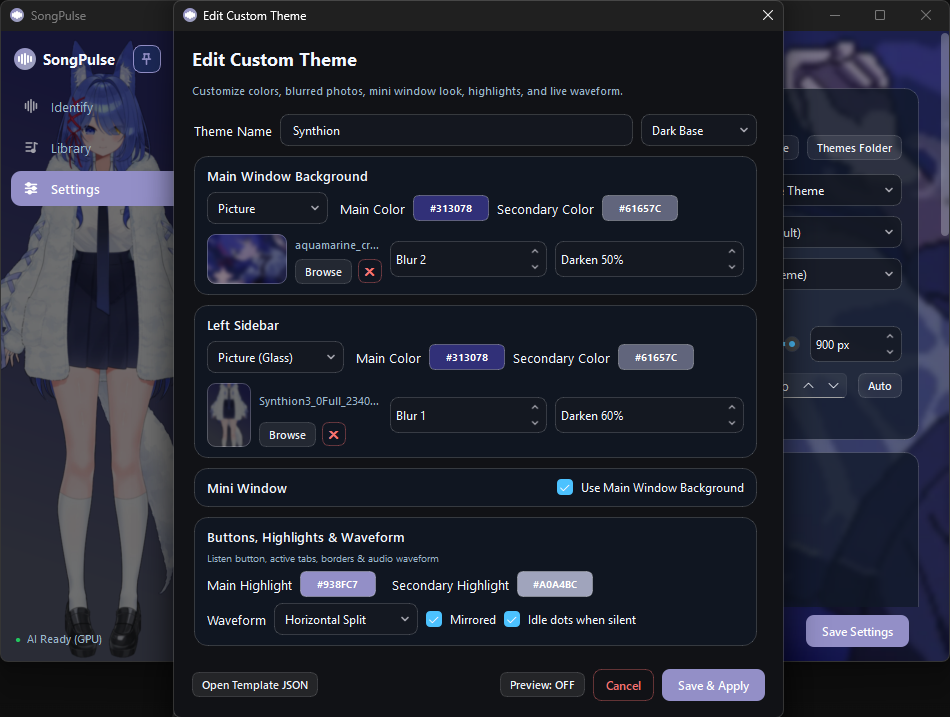
- **Rich Song Details, In-App Artist/Album Popup & Full Web Player:**
  - Dynamic album-art gradient detail view with responsive wrapped platform buttons, separated clickable artist chips, sticky top action bar, centered in-app Artist and Album info popups (clicking the name/title inside opens on your chosen site from Settings), built-in 30s audio preview, and a lightweight **Full Player** web viewer.

  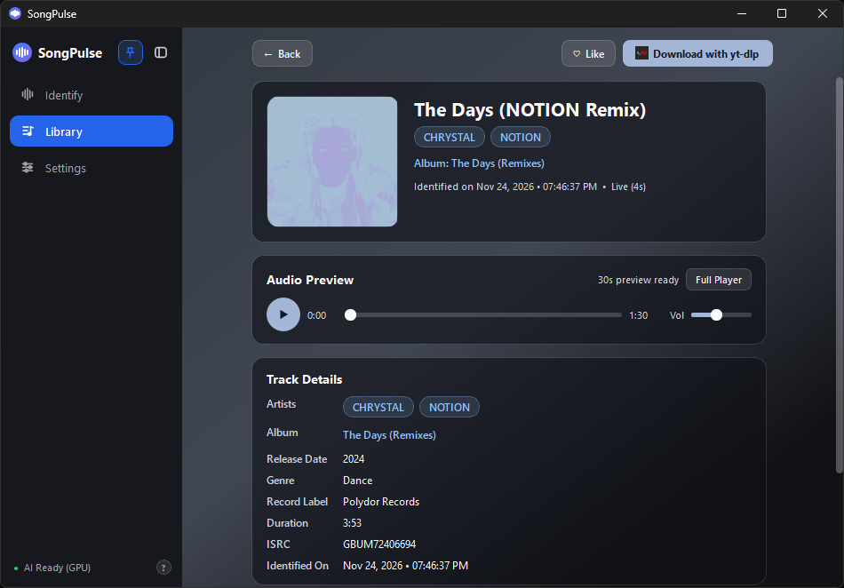
  <br>
  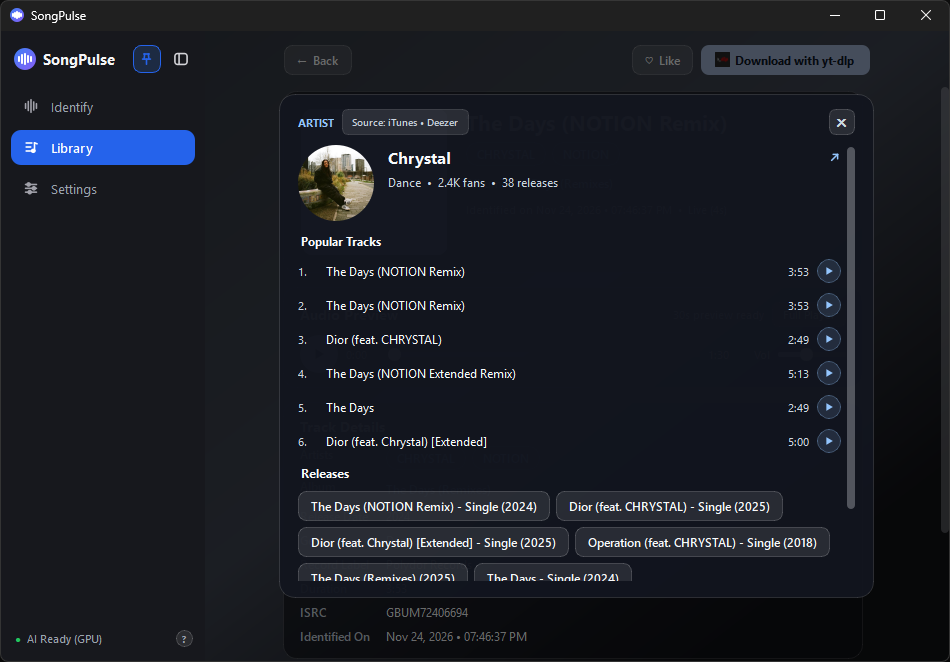 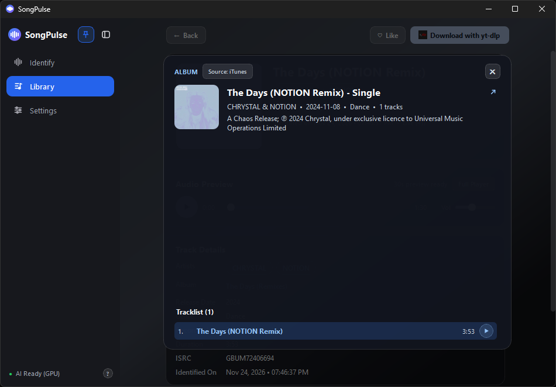

  - Clicking either the themed bottom-right popup or a native Windows toast notification focuses SongPulse directly on that song's detailed view and closes the notification.

  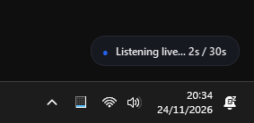 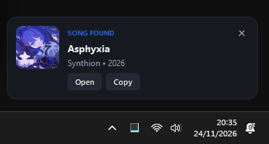
  - Quick links to Shazam, YouTube, YouTube Music, Spotify, Apple Music, SoundCloud, Deezer, Amazon Music, and Tidal, plus one-click **Copy Link** and **Download with yt-dlp** integration (with automatic setup prompt if not installed).
- **Storage Clean-Up & Direct Self-Updater:**
  - Selectively free disk space in **Settings -> Storage & Clean-Up** (temp files, logs, unused or all covers, individual AI models, optional AI engine, or history).
  - Direct in-app **Update Now** in **Settings -> Updates**, plus automatic Visual C++ x64 Runtime check during Setup for fresh PCs.

  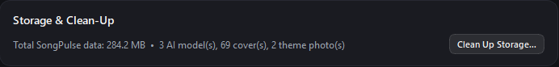
  <br>
  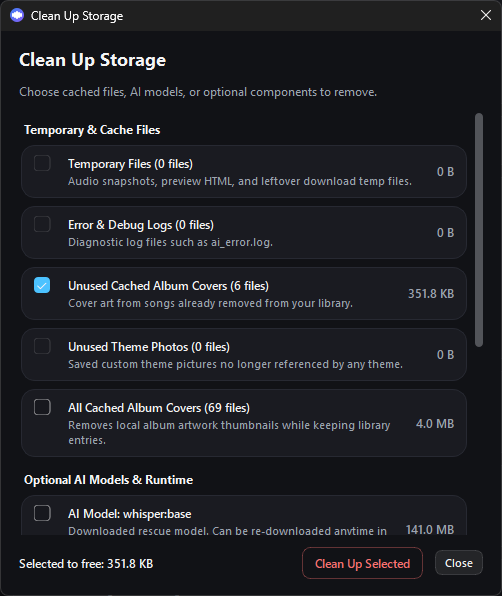

---

## What SongPulse Uses

| Category                          | Tools / Libraries / APIs                                                                                          | Purpose                                                                                                                                               |
| :-------------------------------- | :---------------------------------------------------------------------------------------------------------------- | :---------------------------------------------------------------------------------------------------------------------------------------------------- |
| **Language & UI**                 | Python 3.11+, `PyQt6`, `PyQt6.QtMultimedia`                                                                       | Native Windows Fluent-style interface, custom themes/waveforms, themed overlay notifications, and 30s audio preview playback                          |
| **Audio Engine**                  | `soundcard`, `soundfile`, `numpy`                                                                                 | Multi-device Windows WASAPI loopback capture, optional rolling RAM ring buffer, stereo L/R FFT spectrum visualizer, and WAV mixing                    |
| **Music Recognition**             | `shazamio`                                                                                                        | Acoustic fingerprinting and core song metadata (title, artist, album, label, genre, cover art, lyrics)                                                |
| **Metadata & Preview Enrichment** | iTunes Search API, LRCLIB, YouTube Search                                                                         | Fetches 30-second audio previews, track duration, artist/album info, lyrics rescue search, and direct `youtube.com/watch?v=` links                    |
| **Optional Local AI Rescue**      | `audio-separator`, `faster-whisper`, `onnxruntime-gpu`, `torch`, `torchvision`, `librosa`, `scipy`                | Optional local De-Reverb, De-Echo, DeNoise, Crowd Removal, Whisper Lyrics Rescue, and speed-shift rescue with CUDA GPU acceleration and CPU fallback  |
| **Windows Integration**           | `keyboard`, `winotify`, `ctypes`, `winreg`, `winsound`, `nvidia-smi`                                              | Global shortcuts, clickable Windows toasts (`songpulse://`), DWM titlebars, Always-on-Top pinning, startup tray mode, and live GPU load monitoring    |
| **Packaging**                     | `PyInstaller`, `Inno Setup 7`                                                                                     | Slim `SongPulse_Core` bundle, optional `SongPulse_AI_Pack` zip, and per-user Windows installer                                                        |

---

## Installation

### Option 1: Windows Installer (Recommended)

1. Download `SongPulse_Setup_v1.2.0.exe` from the [Releases](https://github.com/Greatly07/songpulse/releases/latest) page.
2. Run the installer (installs per-user to `%LOCALAPPDATA%\Programs\SongPulse`; no admin rights required).
3. Choose **Compact installation** (Core only, smallest footprint) or **Custom installation** to optionally include the AI Engine and models.
4. Launch **SongPulse** from your Start Menu.

> **Note for GPU Acceleration:** Optional AI rescue models work out of the box on CPU. For faster NVIDIA GPU acceleration, ensure you have an up-to-date NVIDIA driver installed.

### Option 2: Run from Source

1. **Requirements:** Windows 10/11 (64-bit) and Python 3.11+.
2. Clone the repository:
   ```bash
   git clone https://github.com/Greatly07/songpulse.git
   cd songpulse
   ```
3. Install core dependencies:
   ```bash
   pip install -r requirements.txt
   ```
4. *(Optional)* Install local AI tricky-track rescue dependencies:
   ```bash
   pip install -r requirements-ai.txt
   ```
5. Launch the app:
   ```bash
   python songpulse_app.pyw
   ```

---

## Disclaimer

SongPulse is an independent open-source project and is **not affiliated with, endorsed by, or sponsored by** Crypton Future Media, Inc. (Hatsune Miku), TWINDRILL (Kasane Teto), Synthion, `yt-dlp`, Shazam, Apple/iTunes, YouTube, Spotify, SoundCloud, Deezer, Amazon Music, Tidal, LRCLIB, Ultimate Vocal Remover (UVR), or OpenAI (Whisper). All trademarks, character designs, artwork, and brand names belong to their respective owners.
